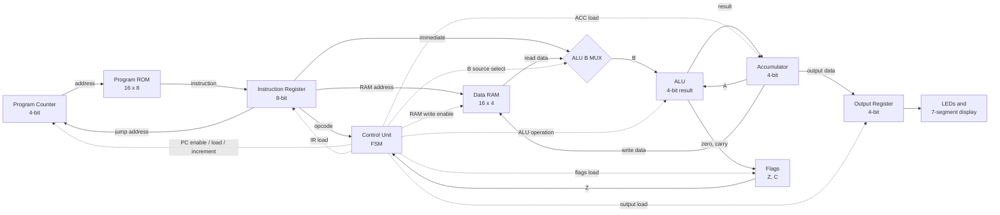
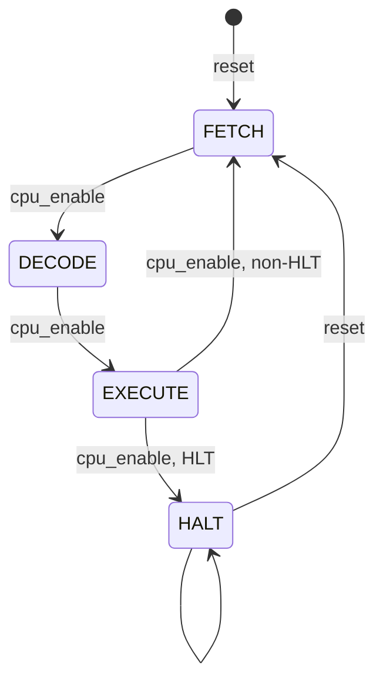

# Tiny4 — 4-Bit CPU on an FPGA

A custom **4-bit, accumulator-based, multicycle CPU**, designed from scratch in Verilog and implemented on a **Digilent Basys 3 (Xilinx Artix-7 XC7A35T) FPGA**.

Tiny4 has its own 8-bit instruction set architecture (ISA), arithmetic logic unit (ALU), program counter, registers, data memory, program ROM, and finite-state-machine (FSM) control unit. It supports manual single-stepping and an automatic slow-run mode, with results displayed on the board's LEDs and seven-segment display.

The current FPGA demonstration runs a **0-to-15 (0-to-F) counter** and then halts. This program exercises immediate loading, addition, zero-flag detection, conditional and unconditional jumps, and output instructions.

## Highlights

- **Custom 8-bit ISA:** 15 defined instructions, including arithmetic, bitwise logic, memory access, branching, output, and halt; one opcode is reserved.
- **4-bit datapath:** Accumulator-based architecture with a 4-bit program counter, 16-word instruction ROM, and 16-word data RAM.
- **Multicycle control:** Three enabled phases per instruction — `FETCH`, `DECODE`, and `EXECUTE` — with a dedicated `HALT` state.
- **Status flags:** Zero and carry/borrow flags captured after supported accumulator/ALU operations.
- **FPGA I/O:** Debounced/synchronized buttons and switch, manual stepping, adjustable automatic execution speed, binary LEDs, and a hexadecimal seven-segment output.
- **Simulation and debugging:** Module-level and CPU-level testbenches, plus an integrated Basys 3 wrapper testbench.

## Architecture and Datapath



Solid arrows carry data; dotted arrows represent control signals. The board wrapper also contains a button/switch conditioner, slow-run pulse generator, and seven-segment decoder (not shown in the core datapath).

### How the datapath works

1. The **program counter (PC)** addresses a `16 x 8` program ROM.
2. During **FETCH**, the selected 8-bit instruction is loaded into the instruction register and the PC increments.
3. The instruction is split into `opcode = IR[7:4]` and `operand = IR[3:0]`. The operand can represent an immediate value, data-memory address, or branch target, depending on the opcode.
4. The control FSM decodes the opcode and, during **EXECUTE**, enables the relevant register write, memory write, ALU operation, or PC update.
5. The **accumulator** supplies ALU input A. Input B is selected from the immediate operand or data RAM. An ALU result is written to the accumulator only when `acc_load` is asserted.
6. When instructed, the zero and carry/borrow flags are stored. `JZ` consults the stored zero flag.
7. `OUT` copies the accumulator into a separate output register. That value drives the four LEDs and the rightmost seven-segment digit.

This is an **accumulator machine**, not a general-purpose-register architecture: most arithmetic operates on the accumulator and writes its result back to the accumulator.

## Control FSM

Each instruction passes through three **enabled** phases. The FSM advances only when `cpu_enable` is asserted; ordinary FPGA clock edges with `cpu_enable = 0` do not advance the CPU.



| State | Encoding | Function |
|---|---|---|
| `FETCH` | `00` | Load the instruction from ROM into the IR and increment the PC. |
| `DECODE` | `01` | Allow the registered instruction to be decoded; no architectural register write is performed. |
| `EXECUTE` | `10` | Perform the selected ALU, load/store, jump, output, or halt operation. |
| `HALT` | `11` | Assert `halted` and hold execution until reset. |

A press of the manual-step button advances **one FSM phase, not one whole instruction**. Normally, three presses are needed to complete an instruction (`FETCH` → `DECODE` → `EXECUTE`).

## Instruction Set Architecture (ISA)

Each instruction is **8 bits**: a 4-bit opcode followed by a 4-bit operand.

```text
  7 6 5 4   3 2 1 0
 +-------+---------+
 | opcode| operand |
 +-------+---------+
```

`ACC` denotes the accumulator, `RAM[x]` a 4-bit data-memory word, `PC` the program counter, and `Z` the stored zero flag.

| Opcode | Instruction | Operand | Operation | Updates flags? |
|---|---|---|---|---|
| `0x0` | `NOP` | — | No operation | No |
| `0x1` | `LDI` | Immediate | `ACC <- imm` | Yes |
| `0x2` | `LDA` | Address | `ACC <- RAM[addr]` | Yes |
| `0x3` | `STA` | Address | `RAM[addr] <- ACC` | No |
| `0x4` | `ADD` | Address | `ACC <- ACC + RAM[addr]` | Yes |
| `0x5` | `SUB` | Address | `ACC <- ACC - RAM[addr]` | Yes |
| `0x6` | `AND` | Address | `ACC <- ACC & RAM[addr]` | Yes |
| `0x7` | `OR` | Address | `ACC <- ACC OR RAM[addr]` | Yes |
| `0x8` | `XOR` | Address | `ACC <- ACC ^ RAM[addr]` | Yes |
| `0x9` | `JMP` | Address | `PC <- addr` | No |
| `0xA` | `JZ` | Address | If `Z = 1`, `PC <- addr` | No |
| `0xB` | `OUT` | Unused | `OUT <- ACC` | No |
| `0xC` | `ADDI` | Immediate | `ACC <- ACC + imm` | Yes |
| `0xD` | `NOT` | Unused | `ACC <- ~ACC` (4-bit result) | Yes |
| `0xE` | Reserved | Unused | Currently behaves like `NOP` | No |
| `0xF` | `HLT` | Unused | Enter the `HALT` state | No |

### ALU operations

| `alu_op` | Operation |
|---|---|
| `000` | Addition |
| `001` | Subtraction |
| `010` | Bitwise AND |
| `011` | Bitwise OR |
| `100` | Bitwise XOR |
| `101` | Bitwise NOT of A |
| `110` | Pass B (used by `LDI` and `LDA`) |
| `111` | Pass A (default) |

The ALU uses a 5-bit temporary result for arithmetic and returns the lower 4 bits to the datapath. Consequently, arithmetic results wrap modulo 16. The **zero flag** indicates a zero 4-bit result. For addition, **carry** records overflow beyond four bits; for subtraction, the same flag is used as a **borrow** indicator when A is less than B. For non-arithmetic ALU operations, the carry flag is set to zero when flags are updated.

### Execute-stage control signals

The control unit gives signals safe defaults in combinational logic, then enables only those required for the active instruction. The table shows the important asserted signals during an **enabled EXECUTE phase**.

| Instruction(s) | ALU operation | Immediate B? | Architectural write / action |
|---|---|---|---|
| `LDI` | Pass B | Yes | Accumulator + flags |
| `LDA` | Pass B | No | Accumulator + flags |
| `STA` | — | — | Data RAM write |
| `ADD`, `SUB`, `AND`, `OR`, `XOR` | Corresponding ALU operation | No | Accumulator + flags |
| `ADDI` | Add | Yes | Accumulator + flags |
| `NOT` | NOT A | No | Accumulator + flags |
| `JMP` | — | — | Load PC from operand |
| `JZ` | — | — | Load PC if zero flag is set |
| `OUT` | — | — | Output register write |
| `NOP`, reserved `0xE`, `HLT` | — | — | No datapath write (`HLT` changes FSM state) |

## FPGA Demonstration: Counting 0 to 15

The current [`program_rom.v`](tiny4_cpu_ews.srcs/sources_1/new/program_rom.v) contains this program:

```verilog
case (addr)
    4'h0: instruction = 8'h10; // LDI 0
    4'h1: instruction = 8'hB0; // OUT
    4'h2: instruction = 8'hC1; // ADDI 1
    4'h3: instruction = 8'hA6; // JZ 6
    4'h4: instruction = 8'hB0; // OUT
    4'h5: instruction = 8'h92; // JMP 2
    4'h6: instruction = 8'hFF; // HLT
    default: instruction = 8'h00;
endcase
```

| ROM address | Machine code | Assembly | Purpose |
|---|---|---|---|
| `0x0` | `0x10` | `LDI 0` | Initialize the accumulator to zero. |
| `0x1` | `0xB0` | `OUT` | Display the initial zero. |
| `0x2` | `0xC1` | `ADDI 1` | Increment the accumulator. |
| `0x3` | `0xA6` | `JZ 6` | If the result became zero, branch to HALT. |
| `0x4` | `0xB0` | `OUT` | Display the incremented value. |
| `0x5` | `0x92` | `JMP 2` | Repeat the increment/check/output loop. |
| `0x6` | `0xFF` | `HLT` | Stop execution. |

**Visible output sequence (hex):** `0, 1, 2, 3, 4, 5, 6, 7, 8, 9, A, B, C, D, E, F`, then halt.

After `F + 1`, the four-bit result wraps to `0`. This sets the zero flag, so `JZ 6` branches to `HLT` **before another `OUT` executes**. Therefore, the display keeps showing **F (15)** when the HALT LED turns on.

This short program demonstrates instruction fetch/decode/execute, ALU addition, the accumulator and output register, status flags, and both kinds of jump. To run a different program, edit the instruction words in `program_rom.v` and rebuild the FPGA bitstream.

## RTL Module Overview

RTL sources are in [`tiny4_cpu_ews.srcs/sources_1/new/`](tiny4_cpu_ews.srcs/sources_1/new/).

| Module | Role |
|---|---|
| [`tiny4_basys3.v`](tiny4_cpu_ews.srcs/sources_1/new/tiny4_basys3.v) | **FPGA top module**: connects the CPU to physical buttons, switch, LEDs, and seven-segment display; implements run/step selection and slow-run timing. |
| [`tiny4.v`](tiny4_cpu_ews.srcs/sources_1/new/tiny4.v) | **CPU core**: instantiates and connects the datapath, flags, memory, and control unit. |
| [`control_unit.v`](tiny4_cpu_ews.srcs/sources_1/new/control_unit.v) | FSM and instruction-dependent control signal generation. |
| [`program_counter.v`](tiny4_cpu_ews.srcs/sources_1/new/program_counter.v) | 4-bit PC with reset, increment, and branch-target load. |
| [`program_rom.v`](tiny4_cpu_ews.srcs/sources_1/new/program_rom.v) | 16-address x 8-bit instruction ROM, currently containing the counter. |
| [`instruction_register.v`](tiny4_cpu_ews.srcs/sources_1/new/instruction_register.v) | Stores the current 8-bit instruction. |
| [`accumulator_register.v`](tiny4_cpu_ews.srcs/sources_1/new/accumulator_register.v) | Stores the CPU's main 4-bit working value. |
| [`alu.v`](tiny4_cpu_ews.srcs/sources_1/new/alu.v) | Arithmetic/logic operations and zero/carry outputs. |
| [`flags_register.v`](tiny4_cpu_ews.srcs/sources_1/new/flags_register.v) | Stores zero and carry/borrow status flags. |
| [`dram.v`](tiny4_cpu_ews.srcs/sources_1/new/dram.v) | 16 x 4 data RAM with combinational read and synchronous write; the filename is `dram.v`, but this is **data RAM**, not an implementation of dynamic RAM (DRAM). |
| [`output_register.v`](tiny4_cpu_ews.srcs/sources_1/new/output_register.v) | Stores the 4-bit value shown externally. |
| [`button_conditioner.v`](tiny4_cpu_ews.srcs/sources_1/new/button_conditioner.v) | Two-stage synchronizer, debounce counter, and one-clock button press pulse. |
| [`hex_to_7seg.v`](tiny4_cpu_ews.srcs/sources_1/new/hex_to_7seg.v) | Converts the 4-bit output to an active-low seven-segment hexadecimal pattern. |

## Basys 3 Board Controls

Pin assignments are defined in [`top.xdc`](tiny4_cpu_ews.srcs/constrs_1/new/top.xdc). The board uses its **100 MHz clock**.

| Physical control / display | Function |
|---|---|
| **BTNC (center button)** | Reset the CPU's PC, instruction register, accumulator, flags, output register, and FSM. |
| **BTNU (up button)** | Manual single-step; each debounced press advances **one CPU phase** when SW0 is off. |
| **SW0 = OFF** | Manual-step mode; the CPU waits for BTNU presses. |
| **SW0 = ON** | Automatic slow-run mode; the CPU advances on periodic enable pulses. |
| **LED0–LED3** | Binary value of the 4-bit output register (`LED0` is the least significant bit). |
| **LED4** | Lights when the CPU enters `HALT`. |
| **Rightmost seven-segment digit (AN0)** | Displays the output value in hexadecimal (`0` through `F`). |
| **Other three digits / decimal point** | Off. |

### Try it on the board

1. Program the FPGA using the generated Tiny4 bitstream.
2. Set **SW0 OFF** and press **BTNC** to reset.
3. Press **BTNU** repeatedly to advance one phase at a time. The displayed value changes when an `OUT` instruction reaches EXECUTE; it will **not** necessarily change after every press.
4. Flip **SW0 ON** to let the program run automatically.
5. Observe the hexadecimal count from `0` through `F` and the **LED4** HALT indicator. Press BTNC to restart.

**Execution speed:** In [`tiny4_basys3.v`](tiny4_cpu_ews.srcs/sources_1/new/tiny4_basys3.v), `PULSE_CYCLES` defaults to `10_000_000`. At 100 MHz, that produces approximately **one CPU-enable pulse every 0.1 seconds**. Each instruction needs three enabled phases (about 0.3 seconds per instruction), and the counter loop needs multiple instructions per displayed increment. **Reducing `PULSE_CYCLES` makes the counter run faster.** Rebuild the bitstream after changing the parameter.

`DEBOUNCE_CYCLES` defaults to `1_000_000` (about 10 ms at 100 MHz). These are separate parameters: debounce time controls how long the input must remain stable; pulse time controls automatic CPU stepping.

## Building and Running

### Requirements

- Digilent **Basys 3** FPGA board (Artix-7 XC7A35T)
- **AMD/Xilinx Vivado** (the repository project was used with Vivado 2023.1; development also used 2025.1)
- USB connection and a working FPGA programming interface

### Synthesis and FPGA programming

1. Clone the repository:

   ```bash
   git clone https://github.com/swaritt2/tiny4.git
   cd tiny4
   ```

2. Open [`tiny4_cpu_ews.xpr`](tiny4_cpu_ews.xpr) in Vivado. Other Vivado releases may ask to upgrade the project.
3. Verify that **`tiny4_basys3`** is the synthesis top module and that [`top.xdc`](tiny4_cpu_ews.srcs/constrs_1/new/top.xdc) is included in the constraints set.
4. Run **Synthesis**, **Implementation**, and **Generate Bitstream**.
5. Connect the Basys 3. In **Hardware Manager**, open the target and program the FPGA with the generated bitstream.
6. Use the board controls above to run the counter in manual or automatic mode.

The RTL is ordinary Verilog, so you can also create a new Vivado project and add the files under `sources_1/new` and the `top.xdc` constraints file if the included project needs reconfiguration.

### Simulation

Testbench sources are in [`tiny4_cpu_ews.srcs/sim_1/new/`](tiny4_cpu_ews.srcs/sim_1/new/).

For a test that uses the **currently checked-in counter ROM**, set **`wrapped_tb`** as the simulation top and select **Run Simulation → Run Behavioral Simulation**. This testbench reduces the pulse and debounce counter parameters so the board-level behavior can be exercised quickly in simulation.

Signals useful for CPU-level waveform inspection include:

```text
DUT.CPU.pc_value
DUT.CPU.ir_word
DUT.CPU.acc_value
DUT.CPU.zero_flag
DUT.CPU.carry_flag
DUT.CPU.CTRL.state
DUT.CPU.output_val
DUT.cpu_enable
DUT.halted_led
```

These paths are shown relative to the `wrapped_tb` testbench instance `DUT`; Vivado's hierarchy browser can be used to add the corresponding signals to the waveform.

## Verification

The repository includes the following simulation testbenches:

| Testbench | What it checks | ROM compatibility |
|---|---|---|
| [`button_conditioner_tb.v`](tiny4_cpu_ews.srcs/sim_1/new/button_conditioner_tb.v) | Input bounce, stable levels, single-cycle press pulses. | Independent of ROM. |
| [`control_unit_tb.v`](tiny4_cpu_ews.srcs/sim_1/new/control_unit_tb.v) | FSM states, opcode control signals, branching, pause/resume, and HALT. | Independent of ROM. |
| [`wrapped_tb.v`](tiny4_cpu_ews.srcs/sim_1/new/wrapped_tb.v) | Board wrapper, manual/automatic mode, timing, debounce, output decoding, and eventual halt. | **Uses current counter ROM.** |
| [`tiny4_tb.v`](tiny4_cpu_ews.srcs/sim_1/new/tiny4_tb.v) | CPU state, execution, pause/resume, and HALT for a short demo program. | Expects an older `LDI 3; ADDI 2; OUT; HLT` ROM. |
| [`tiny4_branch_tb.v`](tiny4_cpu_ews.srcs/sim_1/new/tiny4_branch_tb.v) | JMP, JZ taken/not taken, and branch control behavior. | Expects a separate branch-test ROM. |
| [`tiny4_isa_tb.v`](tiny4_cpu_ews.srcs/sim_1/new/tiny4_isa_tb.v) | Load/store, ALU operations, flags, and RAM state. | Expects a separate ISA-regression ROM. |

**Important:** The CPU-level testbenches for earlier example programs are included as regression references, but their expected instruction streams **do not match the current counter ROM**. To run those tests, first select/recreate the ROM program they expect, or update the testbench expectations. They should not be treated as passing tests against the current `program_rom.v` without changes.

## Design Trade-offs and Current Limitations

- **Four-bit datapath:** Good for understanding register transfers, flags, and wraparound, but values are limited to `0x0`–`0xF`.
- **16 instruction addresses:** The 4-bit PC limits a ROM program to 16 addressable instruction words; jumps also use 4-bit targets.
- **Accumulator ISA:** Keeps the datapath simpler at the cost of additional loads/stores and instructions for more complex tasks.
- **Three phases per instruction:** The multicycle FSM is easy to step and debug but does not overlap instructions like a pipeline.
- **Hardcoded program ROM:** A new program currently requires changing RTL and regenerating the bitstream.
- **Carry flag not used for branching:** The carry/borrow flag is stored but no instruction currently branches on it.
- **RAM initialization:** Data RAM is not initialized by the CPU reset circuitry. Programs should write a RAM location before relying on its value.

## Future Work

- **More capable ISA:** Give reserved opcode `0xE` a function such as `JC` (jump on carry), and explore better support for arithmetic across multiple words.
- **Larger architecture:** Extend the datapath, PC, memories, and instruction encoding to support wider operands and larger programs.
- **Performance improvements:** Explore pipelining and the data/control hazards it introduces, rather than simply adding stages to the existing FSM.
- **Better program loading and verification:** Separate program images from the ROM RTL and make the full regression suite easily repeatable.
- **ASIC implementation:** Take the RTL through synthesis, floorplanning, placement and routing, static timing analysis, and timing closure to learn the full digital ASIC design flow.

## What I Learned

I started Tiny4 to go beyond the processor concepts I learned in ECE 120 and understand how a CPU works at the register-transfer level. Choosing a **4-bit design** was intentional: it forced me to think about every instruction encoding, data path, and control signal instead of relying on a more flexible architecture.

Designing the ISA highlighted the trade-offs between **hardware simplicity and software flexibility**. An accumulator architecture reduced datapath complexity, but made some programs take more instructions. Debugging interactions between FETCH, DECODE, and EXECUTE showed me the value of a clean control FSM, meaningful waveforms, and the ability to advance the hardware one phase at a time.

Most importantly, the project strengthened my interest in **computer architecture and RTL/digital hardware design**. I enjoyed being able to trace how individual bits move through a processor I built myself. My next goal is to apply these lessons to more advanced designs and eventually take a project through the complete ASIC implementation flow.

## Author

**Swarit Tumuluri**  
Computer Engineering — University of Illinois Urbana-Champaign  
[LinkedIn](https://linkedin.com/in/swarit-t-3822b12a7)
